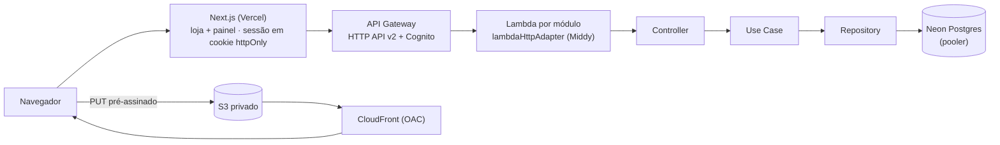

# Trezzy Store

E-commerce de streetwear serverless na AWS, num monorepo com a API e o frontend. O backend roda em Node.js no AWS Lambda, sobre um mini-framework próprio (injeção de dependências, Controllers e Use Cases sobre Middy). O frontend é Next.js 16, com a loja e o painel administrativo no mesmo app.

> **Status:**
> - **API:** autenticação com Cognito, RBAC por permissões e catálogo do painel (marcas, categorias e produtos com variantes e galeria). Fotos com upload direto para o S3 e entrega pelo CloudFront.
> - **Painel:** cadastra produtos de verdade, com fotos, variantes geradas pela grade da categoria e erros por campo.
> - **Em construção:** a loja, já desenhada e navegável, ainda lê dados de exemplo até a API ganhar as rotas públicas (`/store/...`).

## Stack

| Camada | Tecnologia |
| :--- | :--- |
| Runtime | Node.js 24 · AWS Lambda (arm64, ESM) |
| API | API Gateway HTTP API v2 · Middy 7 |
| Infra como código | Serverless Framework v4 (esbuild) |
| Banco | Neon Postgres · Drizzle ORM |
| Fotos | Amazon S3 (privado, upload por URL pré-assinada) · CloudFront com Origin Access Control |
| Auth | Amazon Cognito (Essentials) + JWT authorizer do API Gateway |
| Frontend | Next.js 16 (App Router, Cache Components, React Compiler) · React 19 · Tailwind v4 · shadcn/ui sobre Base UI |
| Formulários | react-hook-form + `@hookform/resolvers` (zod), com uma porta só no código |
| Validação | Zod 4, na API e no frontend |
| Qualidade | TypeScript strict · ESLint (com as regras de arquitetura) · Vitest · Husky · commitlint · GitHub Actions |
| Deploy | AWS (api) e Vercel (web), com versões separadas |

## Arquitetura



```text
api/src/
├── kernel/        # container de DI e decorators (@Injectable, @Schema)
├── shared/        # configuração tipada e validada (env.ts → AppConfig)
├── application/   # entities, errors, authorization, useCases (negócio), controllers (HTTP → use case)
├── infra/         # Drizzle, repositórios, clients (SDKs) e gateways (S3, Cognito)
└── main/          # adapter Middy, middlewares e entrypoints das Lambdas

web/src/
├── app/           # rotas: (store) a loja, (admin) o painel
├── features/      # store/*, admin/*, shared/auth: data (I/O) · model (regra) · containers · components
├── components/    # ui (shadcn) · common · store · admin
└── lib/ · config/ # utilitários sem domínio e variáveis validadas com zod
```

Uma requisição à API percorre este caminho:

1. O API Gateway valida o JWT (e o scope de admin, nas rotas do painel) e invoca a Lambda do módulo.
2. O adapter despacha pelo `routeKey` e confere a permissão da rota.
3. O controller valida a entrada com Zod e chama um use case.
4. O use case orquestra entidades, repositórios e gateways.
5. Erros viram um envelope padrão: `{ "error": { "code", "message" } }`.

As dependências entre camadas são **impostas pelo ESLint**, nos dois apps. Um controller que importa um repositório, um use case que importa `drizzle-orm` ou uma feature da loja que importa o painel não passam no lint.

## Como uma foto vira produto

O arquivo nunca passa pela Lambda: ele vai do navegador direto para o S3, e a API só autoriza e confere.

```text
Painel                          API (Lambda media)                 S3 / CloudFront
  │ POST /admin/media ───────────▶ cria a mídia pendente
  │ { contentType, sizeBytes }    assina um PUT de 5 min (tipo e tamanho na assinatura)
  │ PUT uploadUrl (o arquivo) ────────────────────────────────────▶ uploads/<uuid>.<ext>
  │ POST /admin/media/{id}/confirm ▶ lê os 12 primeiros bytes ◀──── Range GET
  │                                tipo, tamanho e assinatura do arquivo batem? 204 : 409 e apaga
  │ POST /admin/products { …, mediaIds: [capa, …] }
  │                                produto, variantes e galeria numa transação
  │ GET /admin/products ──────────▶ coverUrl = https://<cdn>/uploads/<uuid>.<ext>
```

## Decisões técnicas

Cada uma veio de um problema concreto. As de performance foram medidas antes de virar regra.

**Backend**
- **Uma Lambda por módulo** (`products`, `media`, `brands`…) com roteamento interno. Fica no meio-termo entre uma função por rota (muitos cold starts) e uma Lambda única (blast radius grande).
- **DI própria via `reflect-metadata`.** O grafo controller → use case → repositório é montado sozinho, com singletons reaproveitados entre invocações. O container usa a classe como token e falha no cold start, com mensagem clara, diante de dependência inválida ou ciclo.
- **Erros desacoplados de HTTP.** O use case lança `ApplicationError(ErrorCode.NOT_FOUND, …)`, e a camada HTTP deriva o status por um mapa exaustivo: um código novo sem status não compila.
- **Neon com Pool WebSocket**, para ter transações interativas. Cada container mantém no máximo uma conexão, e o PgBouncer do Neon absorve a concorrência.
- **Conflito de concorrência vira 409, não 500.** Título, SKU e fotos são validados antes da transação. Se dois admins salvam ao mesmo tempo, o `unique` do banco barra o segundo, e o repositório traduz a constraint num erro claro.

**Segurança e acesso**
- **Autenticação no API Gateway** (Cognito): token inválido é rejeitado antes de invocar a Lambda.
- **Conta no nosso banco; o Cognito guarda identidade e tipo de conta.** O id nasce na entidade `Account` e vai para o Cognito no cadastro (`custom:internalId`, imutável). O trigger `PreTokenGeneration` o injeta no access token. Trocar de provedor de auth custa remapear uma coluna, um gateway e a lista de admins.
- **Saga só onde há dois sistemas.** O cadastro de conta escreve no Cognito e no banco, que não compartilham transação: cada passo registra sua compensação, e uma falha desfaz os anteriores na ordem inversa. O cadastro de produto escreve só no banco, então é uma transação comum.
- **RBAC em duas camadas.** O grupo `admin` do Cognito vira um scope no token, e o API Gateway barra quem não é admin antes da Lambda. Dentro da API, cada rota exige uma permissão (`products:write`, `media:write`), nunca um papel. Cargos como financeiro ou gerente entram depois, no nosso banco, sem mudar rotas nem o front, que monta o menu pelo `GET /me/permissions`.
- **Menor privilégio na infra.** Só a função de mídia tem role com acesso ao S3, nativa do Serverless 4.44 e sem plugin. As outras funções nunca conseguem assinar um upload nem apagar uma foto.

**Fotos**
- **Upload direto ao S3 por URL pré-assinada.** A Lambda síncrona aceita no máximo 6 MB e cobraria o tempo do upload. Assim, a função responde em milissegundos.
- **A assinatura prende tipo e tamanho, e a API confere os bytes.** O `Content-Type` é declarado por quem envia. Os primeiros bytes (JPEG, PNG, WebP) são o arquivo de verdade: um HTML disfarçado de PNG é recusado e apagado. Dois detalhes do SDK que quebravam o upload do navegador ficaram travados por teste: o checksum de corpo vazio e o `Content-Type` fora da assinatura.
- **Bucket privado, servido só pelo CloudFront (OAC), com `nosniff`.** O navegador nunca trata uma foto como HTML ou script.
- **A URL não é guardada.** O banco guarda só a `key` (`uploads/<uuid>.<ext>`), e a URL sai do domínio do CDN mais a `key`. Um UUID não se adivinha, nunca colide e nunca muda de conteúdo, o que permite cache longo. Trocar o CDN não exige migration.
- **Uma cor com fotos próprias é um produto.** Cada cor de um tênis tem código próprio no fabricante, URL, card e foto certa. As cores do mesmo modelo serão ligadas por uma "família", com as bolinhas da loja levando ao produto irmão.

**Frontend**
- **BFF de sessão.** O Next guarda os tokens em cookies `__Host-`, `httpOnly` e `Secure`, e o navegador nunca os vê: um XSS não consegue roubá-los. A API continua autenticando e autorizando tudo.
- **Dados da loja pelo cache do Next** (`'use cache'` com tags), sem React Query. O painel invalida a tag `catalog` quando cadastra um produto.
- **Um padrão de formulário, imposto pelo lint.** Só `lib/form.ts` importa o react-hook-form. Todo campo passa pelo `FormField`, montado sobre o `Field` do shadcn, que liga label, descrição, erro e os atributos de acessibilidade sozinho. Os erros da Server Action caem no campo certo pelo mesmo caminho (`variants.1.sku`).
- **Server Action devolve resultado, não redireciona.** O formulário é limpo antes de navegar, porque o Next guarda a página escondida (`<Activity>`) e ela voltaria preenchida.

**Build e operação**
- **Decisões de build tomadas por medição:**
  - `moduleResolution: Bundler` gera build e bundle idênticos aos do `NodeNext`, então os imports ficaram limpos;
  - `minify` foi mantido porque reduz ~11% do tempo de carga a frio;
  - source maps ficaram de fora (+15%);
  - `import * as z from 'zod'` (imposto pelo lint) corta o bundle de 731 para 361 KB e a carga a frio em 15%; o `zod/mini` foi avaliado e descartado.
- **Infra de produção:**
  - arm64 (Graviton), 512 MB, logs JSON com retenção de 30 dias;
  - versão do Serverless fixada;
  - deploy e build falham se faltar variável obrigatória;
  - bucket de fotos com `Retain` em produção.
- **Versões separadas por app** (SemVer): a api (`vX.Y.Z`) e o web (`web-vX.Y.Z`) têm deploys independentes, e a versão sai dos commits que mudam cada um.

## Fluxo de trabalho

- Uma branch por feature → PR para `develop` → release `develop` → `main`. A CI barra PR para `main` que não venha da `develop`.
- Conventional Commits com escopo (`feat(api/media): …`), um commit por contexto, e cada um passa typecheck, lint e testes sozinho.
- A CI roda, em todo PR para `develop` e `main`, lint, typecheck e testes da api e lint, typecheck, testes e build do web.

## Rodando localmente

Pré-requisitos:

- Node.js 24 e pnpm 12.
- Um banco [Neon](https://neon.com) (endpoint `-pooler`).
- Para build e deploy da API: conta AWS e login no Serverless Framework v4.

```bash
pnpm install
cp api/.env.example api/.env   # preencha DATABASE_URL
cp web/.env.example web/.env.local   # API_URL e MEDIA_CDN_HOSTNAME (saídas do deploy da api)
```

API:

```bash
pnpm --filter trezzy-api test        # testes
pnpm --filter trezzy-api lint        # lint + fronteiras entre camadas
pnpm --filter trezzy-api typecheck   # tsc --noEmit
pnpm --filter trezzy-api package     # build da Lambda (sem deploy)
pnpm --filter trezzy-api run deploy  # deploy no stage dev (run deploy:prod para produção); sem o run, o pnpm chama o próprio `pnpm deploy`
pnpm --filter trezzy-api db:generate # gerar migration (db:migrate aplica)
pnpm --filter trezzy-api db:seed     # cria as marcas e categorias da loja (pode rodar de novo)
pnpm --filter trezzy-api account:admin <email> add   # promove a conta a admin (stage dev; remove para rebaixar)
```

Web:

```bash
pnpm --filter trezzy-web dev         # http://localhost:3000 (loja) e /admin (painel)
pnpm --filter trezzy-web test        # testes
pnpm --filter trezzy-web lint        # lint, tokens de design e fronteiras entre áreas
pnpm --filter trezzy-web typecheck   # next typegen + tsc
pnpm --filter trezzy-web build       # build de produção
```

## Contribuindo

As regras do projeto (camadas, convenções, Definition of Done) estão no [AGENTS.md](AGENTS.md), e as do frontend no [web/AGENTS.md](web/AGENTS.md). Os dois servem para pessoas e para agentes de IA.

## Licença

[MIT](LICENSE)
