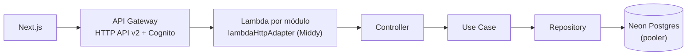

# Trezzy Store

E-commerce serverless na AWS. O backend roda em Node.js no AWS Lambda, sobre um mini-framework próprio (injeção de dependências, Controllers e Use Cases sobre Middy). O frontend será em Next.js.

> **Status:** fundação do backend pronta (DI, pipeline HTTP, erros, banco e infra). Módulos de negócio e frontend em construção.

## Stack

| Camada | Tecnologia |
| :--- | :--- |
| Runtime | Node.js 24 · AWS Lambda (arm64, ESM) |
| API | API Gateway HTTP API v2 · Middy 7 |
| Infra como código | Serverless Framework v4 (esbuild) |
| Banco | Neon Postgres · Drizzle ORM |
| Auth | Amazon Cognito + JWT authorizer do API Gateway (planejado) |
| Validação | Zod 4 |
| Qualidade | TypeScript strict · ESLint · Vitest · Husky · commitlint · GitHub Actions |

## Arquitetura



```text
api/src/
├── kernel/        # container de DI e decorators (@Injectable, @Schema)
├── shared/        # configuração tipada e validada (env.ts → AppConfig)
├── application/   # contracts, errors, useCases (negócio), controllers (HTTP → use case)
├── infra/         # Drizzle, repositórios, integrações externas
└── main/          # adapter Middy, middlewares e entrypoints das Lambdas
```

Uma requisição percorre este caminho:

1. O API Gateway invoca a Lambda do módulo.
2. O adapter despacha pelo `routeKey`.
3. O controller valida a entrada com Zod e chama um use case.
4. O use case orquestra repositórios.
5. Erros viram um envelope padrão: `{ "error": { "code", "message" } }`.

As dependências entre camadas são **impostas pelo ESLint**: um controller que importa um repositório, ou um use case que importa `drizzle-orm`, não passa no lint.

## Decisões técnicas

- **Uma Lambda por módulo** (`products`, `orders`…) com roteamento interno. Fica no meio-termo entre uma função por rota (muitos cold starts) e uma Lambda única (blast radius grande).
- **DI própria via `reflect-metadata`.** O grafo controller → use case → repositório é montado automaticamente, com singletons reaproveitados entre invocações. O container usa a classe como token e falha no cold start, com mensagem clara, diante de dependência inválida ou ciclo.
- **Erros desacoplados de HTTP.** O use case lança `ApplicationError(ErrorCode.NOT_FOUND, …)` e a camada HTTP deriva o status por um mapa exaustivo: um código novo sem status não compila.
- **Neon com Pool WebSocket**, para ter transações interativas (checkout e SAGA). Cada container mantém uma conexão no máximo, e o PgBouncer do Neon absorve a concorrência.
- **Autenticação no API Gateway** (Cognito): token inválido é rejeitado antes de invocar a Lambda.
- **Decisões de build tomadas por medição:**
  - `moduleResolution: Bundler` gera build e bundle idênticos aos do `NodeNext`, então os imports ficaram limpos;
  - `minify` foi mantido porque reduz ~11% do tempo de carga a frio;
  - source maps ficaram de fora (+15%).
- **Infra de produção:**
  - arm64 (Graviton), 512 MB, logs JSON com retenção de 30 dias;
  - versão do Serverless fixada;
  - deploy falha se faltar variável obrigatória.

## Rodando localmente

Pré-requisitos:

- Node.js 24 e pnpm 12.
- Um banco [Neon](https://neon.com) (endpoint `-pooler`).
- Para build e deploy: conta AWS e login no Serverless Framework v4.

```bash
pnpm install
cp api/.env.example api/.env   # preencha DATABASE_URL

pnpm --filter trezzy-api test        # testes
pnpm --filter trezzy-api lint        # lint + fronteiras entre camadas
pnpm --filter trezzy-api typecheck   # tsc --noEmit
pnpm --filter trezzy-api package     # build da Lambda (sem deploy)
pnpm --filter trezzy-api deploy      # deploy no stage dev (deploy:prod para produção)
pnpm --filter trezzy-api db:generate # gerar migration (db:migrate aplica)
```

## Contribuindo

As regras do projeto (camadas, convenções, Definition of Done) estão no [AGENTS.md](AGENTS.md), que serve para pessoas e para agentes de IA. Commits seguem Conventional Commits com escopo, por exemplo `feat(api/products): …`.

## Licença

[MIT](LICENSE)
